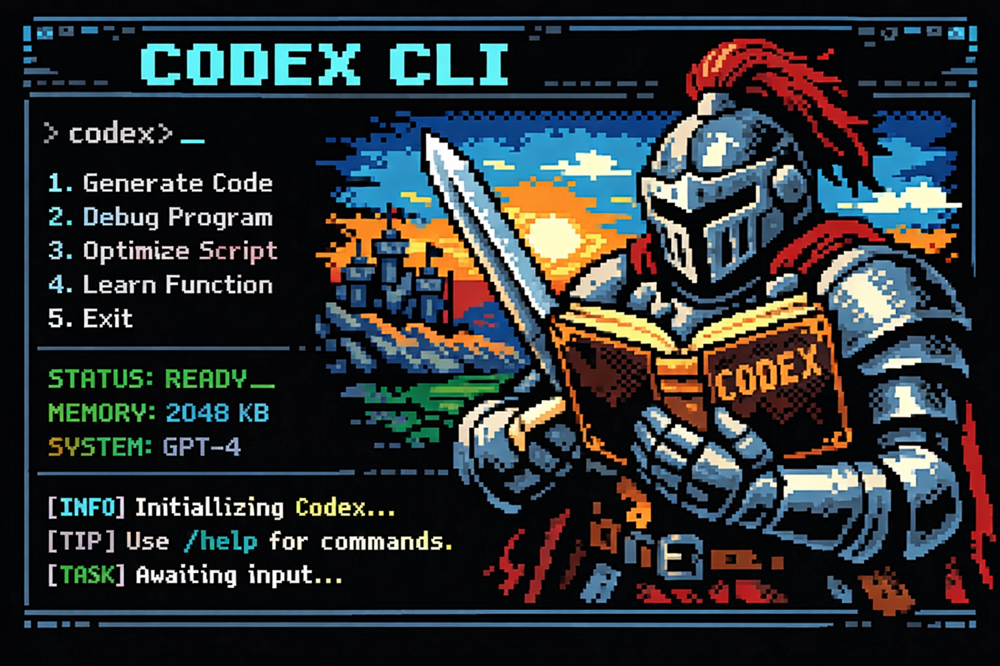

# Codex CLI

A retro fantasy command-line interface for coding workflows.



This project explores a more accessible, concept-oriented CLI inspired by an
8-bit knight-and-codex aesthetic. The user is the knight, the CLI is the codex,
and common development tasks are exposed as memorable commands like `goblin`,
`alchemy`, and `coins`.

## Vision

- Intuitive, human-first commands
- Light fantasy theme without sacrificing clarity
- Python-based interface layer
- Easy to package into a standalone executable later

## Planned Commands

- `/codex-open` or `help`: show command help
- `/goblin` or `fix`: investigate a bug
- `/alchemy` or `test`: verify or test a fix
- `/coins` or `usage`: show usage information
- `/dragons` or `doctor`: inspect deployment or production failures
- `/scroll` or `explain`: explain code or files
- `/map` or `repo`: orient around the repository
- `/quest` or `forge`: start a new implementation task

## Quick Start

```bash
python3 -m venv .venv
source .venv/bin/activate
pip install -e .
codex-open
codex-open /goblin "login breaks on mobile"
codex-open /alchemy
```

You can also use plain aliases:

```bash
codex-open help
codex-open fix "broken login flow"
codex-open test
```

## Project Layout

```text
src/codex_cli/
  main.py
  console.py
  theme.py
  state.py
  commands.py
tests/
```

## Notes

This scaffold is intentionally thin. It focuses on:

- command grammar
- visual tone
- session/config foundations
- future compatibility with a backend agent or API layer
