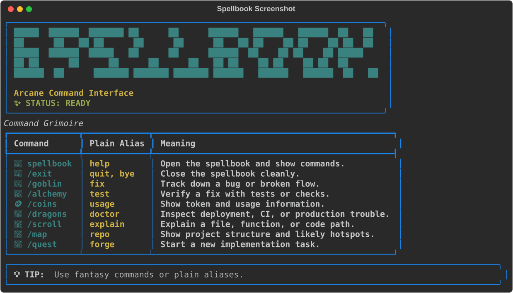

# Spellbook

A retro fantasy command-line spellbook for coding workflows.

This project explores a more accessible, concept-oriented tool inspired by an
arcane spellbook aesthetic. Common development tasks are exposed as memorable
commands like `goblin`, `alchemy`, and `coins`.



## Vision

- Intuitive, human-first commands
- Light fantasy theme without sacrificing clarity
- Python-based interface layer
- Easy to package into a standalone executable later

## Planned Commands

- `spellbook` or `help`: show command help
- `/goblin` or `fix`: investigate a bug
- `/alchemy` or `test`: verify or test a fix
- `/coins` or `usage`: show usage information
- `/dragons` or `doctor`: inspect deployment or production failures
- `/scroll` or `explain`: explain code or files
- `/map` or `repo`: orient around the repository
- `/quest` or `forge`: start a new implementation task

## Quick Start

```bash
python3 -m venv .venv
source .venv/bin/activate
pip install -e .
spellbook
spellbook /goblin "login breaks on mobile"
spellbook /alchemy
```

You can also use plain aliases:

```bash
spellbook help
spellbook fix "broken login flow"
spellbook test
```

## Project Layout

```text
src/spellbook/
  main.py
  console.py
  theme.py
  state.py
  commands.py
tests/
```

## Notes

This scaffold is intentionally thin. It focuses on:

- command grammar
- visual tone
- session/config foundations
- future compatibility with a backend agent or API layer

## Contributing

Spellbook is early and intentionally approachable. Good first contributions are:

- Make existing commands functional, starting with `/alchemy`, `/map`, and `/scroll`
- Add tests for command aliases and terminal rendering helpers
- Improve terminal layout across different terminal widths
- Add new themed commands, such as `🏰 /castle` for model/provider information
- Keep the fantasy theme playful without making command behavior unclear

To work locally:

```bash
python3 -m venv .venv
source .venv/bin/activate
pip install -e ".[dev]"
pytest
spellbook
```

Please keep changes small, tested, and easy to understand.
